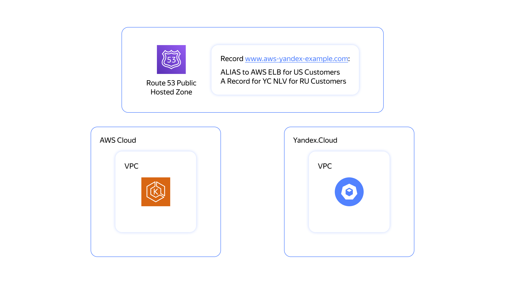

## Описание сценария и реализация решения 

Этот сценарий ориентирован на клиентов, которые выбрали Kubernetes в качестве базовой технологии PaaS. Такие клиенты могут сталкиваться с проблемой отсутствия дата-центров AWS в ряде регионов, где находятся их пользователи (например, в России). Для решения этой проблемы пользователи могут развернуть удаленный кластер Kubernetes в Yandex Cloud и интегрировать сервисы из своих кластеров в систему управления глобальными сервисами.

Например, в этом решении основное приложение может быть установлено в AWS, а удаленное приложение, развернутое в удаленном кластере, — в Yandex Cloud. Они оба используют Route 53 с региональной маршрутизацией: запросы из США перенаправляются на американский сайт, а из России — на российский.


<p align="center">
    
</p>


## Предварительные условия

- Аккаунты в AWS и Yandex Cloud.
- Оболочка Bash.
- Terraform версии 1.1.5.
- Инструмент `curl`.
- Утилитa `jq`.

Настройте инфраструктуру AWS:
- Настройте [AWS CLI](https://docs.aws.amazon.com/cli/latest/userguide/cli-chap-configure.html).

Настройте инфраструктуру Yandex Cloud:
- Настройте [YC CLI](https://yandex.cloud/docs/cli/quickstart).
- Экспортируйте данные конфигурации Yandex Cloud для провайдера Terraform:
```
export YC_TOKEN=$(yc iam create-token)
export YC_CLOUD_ID=$(yc config get cloud-id)
export YC_FOLDER_ID=$(yc config get folder-id)
```

## Начало работы

### Настройте доменное имя публичной DNS-зоны

Укажите значение переменной `aws_domain_name` в файле [`variables.tf`](example/variables.tf).

### Запустите демонстрационный сценарий 

Убедитесь, что для публичных ключей используется путь `~/.ssh/id_rsa.pub`:

```
cd example
terraform init
terraform apply # use -var=public_key_path='another_path_to_ssh_public_key' if you your ssh key is located somewhere else
```

Подождите примерно 10 минут.


### Проверьте результат

Запустите `curl` для обоих подов, развернутых в разных кластерах:

```
curl $(terraform output eks_lb_ip)
curl $(terraform output yc_lb_ip)
```

Проверьте работоспособность глобального DNS-сервиса Route 53:

1. Перейдите в [консоль AWS]({{ link-console-main }}).
1. Выберите **Route 53 Service**.
1. Выберите `aws-yandex-example.com` (ваше доменное имя).
1. Нажмите кнопку **Test Connection** (тестировать соединение).

Проверьте WWW-запись с разных адресов резолверов:

1. Используйте IP-адрес Google DNS, чтобы эмулировать клиента из США: 8.8.8.8.
1. Используйте IP-адрес Yandex DNS, чтобы эмулировать клиента из России: 87.250.250.1.
